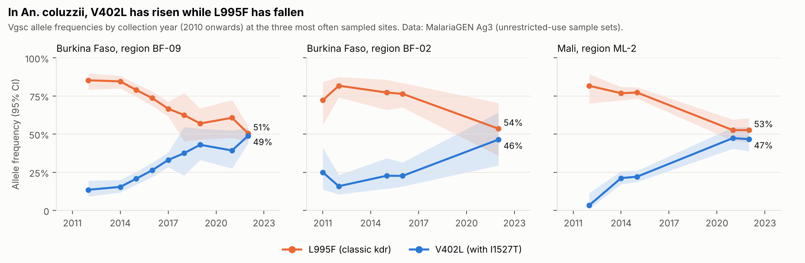
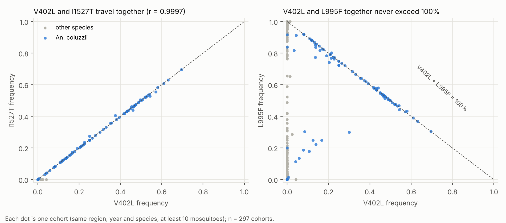

# Insecticide-resistance alleles in African malaria mosquitoes: a population-genomic survey of *Vgsc*

An analysis of 22,038 wild-caught *Anopheles* mosquitoes from the MalariaGEN Ag3 resource, tracking amino-acid
changes in the voltage-gated sodium channel (*Vgsc*), the target of the pyrethroid insecticides used on bed nets.

**Question.** Two *Vgsc* alleles, **V402L** and **I1527T**, were reported rising in frequency in Burkina Faso
(Kientega et al. 2024). Across all unrestricted Ag3 data, where else do they occur, are they changing over time, and
how do they relate to the classic knock-down resistance (*kdr*) allele **L995F**?



## Data and method
- **Data:** MalariaGEN *Anopheles gambiae* 1000 Genomes (Ag3), accessed in Google Colab with the `malariagen_data`
  Python package. Only sample sets marked **unrestricted use** were loaded (87 sets, releases 3.0–3.13), so the results
  can be shared publicly.
- **Cohorts:** mosquitoes grouped by region (admin level 1), collection year and species; cohorts with fewer than 10
  mosquitoes dropped (297 cohorts remain).
- **Frequencies:** amino-acid allele frequencies on the *Vgsc* transcript AGAP004707-RD for five alleles: L995F,
  L995S, N1570Y, V402L and I1527T; 95 % Wilson intervals from allele counts.
- **Answer key:** the established alleles must reproduce their published distribution before the new ones are
  interpreted.

## Results
All numbers are in [`results/summary.md`](results/summary.md).

**1. The method reproduces the known picture.** L995S reaches 97–100 % in *An. gambiae* from Uganda, Tanzania and
the DR Congo; L995F is widespread in West Africa; and N1570Y never exceeds L995F in any cohort, consistent with its
known occurrence only on the L995F background.

**2. V402L and I1527T travel together.** Across 297 cohorts their frequencies are almost identical (r = 0.9997;
largest difference 4 percentage points). I1527T never occurs without V402L. This matches the tight linkage of the two
substitutions reported in the Ag1000G phase 2 analysis (Clarkson et al. 2021).

**3. They are an *An. coluzzii* phenomenon, across West Africa and beyond.** All 82 cohorts with V402L at 5 % or
more are *An. coluzzii*, in 12 countries: Benin, Burkina Faso, Cameroon, Côte d'Ivoire, The Gambia, Ghana, Guinea,
Kenya, Mali, Nigeria, Senegal and South Sudan. The highest frequencies are in recent Nigerian and Burkinabè samples
(up to 70 % in Taraba, Nigeria, 2022).

**4. V402L has risen as L995F has fallen.** At the three most often sampled *An. coluzzii* sites:

| Site | V402L | L995F |
|---|---|---|
| Burkina Faso, BF-09 | 14 % (2012) → 49 % (2022) | 85 % → 51 % |
| Burkina Faso, BF-02 | 25 % (2011) → 46 % (2022) | 72 % → 54 % |
| Mali, ML-2 | 3 % (2012) → 47 % (2022) | 82 % → 53 % |

**5. The two kinds of resistance allele look complementary.** In *An. coluzzii*, V402L and L995F frequencies add up
to almost exactly 100 % in many cohorts and never exceed it (maximum 102 %, within sampling error). The simplest
reading is that, in these populations, nearly every *Vgsc* copy carries one resistance allele or the other, and the
susceptible form has almost disappeared. This fits the published suggestion that V402L competes with L995F rather
than adding to it (Perugini et al. 2024).



## What this does and does not show
- **Not a new discovery.** The V402L–I1527T linkage and the rise of V402L in *An. coluzzii* are already published.
  What this adds is an update across all unrestricted Ag3 releases up to 2023, in one reproducible notebook.
- **Frequencies, not haplotypes.** Points 2 and 5 are inferred from allele frequencies. Proving that V402L and L995F
  sit on different chromosomes needs phased haplotype data, available in Ag3 and the obvious next step.
- **Uneven sampling.** Some country–years have hundreds of mosquitoes, others barely 10; some sites are sampled in
  only a few years. The trend lines join the years that exist, and the intervals are wide where samples are small.
- **Presence is not resistance.** Allele frequencies do not measure how resistant mosquitoes are; that needs
  bioassays and functional work.
- **Unrestricted data only.** Embargoed sample sets were excluded, so the most recent collections may be missing.

## Run it
1. Register for MalariaGEN data access (Vector Observatory data-access page) with the Google account you use in Colab.
2. Open `notebooks/vgsc_resistance_alleles.ipynb` in Google Colab, check the machine is in the US region, and choose
   `Runtime → Run all`. It downloads `results.zip`.
3. Put the CSV files into `results/tables/` and run:
   ```bash
   pip install -r requirements.txt
   python scripts/summarise_results.py
   ```
The notebook in this repository is the version that produced these results. The full frequency table
(`vgsc_aa_frequencies_all.csv`) is stored gzipped; pandas reads it directly.

## Layout
```
notebooks/   vgsc_resistance_alleles.ipynb   data access and frequency analysis (Colab)
results/     tables/ (sample sets, cohorts, allele frequencies, Burkina Faso time series), summary.md
figures/     vgsc_trends.png, vgsc_linkage.png
scripts/     summarise_results.py           summary and figures from the tables
docs/        LEARNING_LOG.md                questions I can answer about every step
```

## References
- Clarkson CS et al. (2021) The genetic architecture of target-site resistance to pyrethroid insecticides in the
  African malaria vectors *Anopheles gambiae* and *Anopheles coluzzii*. *Molecular Ecology*.
  https://pmc.ncbi.nlm.nih.gov/articles/PMC9019111
- Kientega M et al. (2024) Whole-genome sequencing of major malaria vectors reveals the evolution of new insecticide
  resistance variants in a longitudinal study in Burkina Faso. *Malaria Journal*.
  https://doi.org/10.1186/s12936-024-05106-7
- Perugini E et al. (2024) Co-occurrence of 1014F, 1014S and 402L mutations in *Anopheles coluzzii* and
  *Anopheles arabiensis* in Burkina Faso. *Malaria Journal*. https://doi.org/10.1186/s12936-024-05069-9
- MalariaGEN Vector Observatory, Ag3 data resource, and the `malariagen_data` Python package.

## How this was built
The code was written with the help of an AI assistant (Claude). I ran the analysis, checked the results against the
published studies and wrote the interpretation.

## Licence and credits
Code: MIT. Data: MalariaGEN Vector Observatory and its partner studies, used under the MalariaGEN terms of use
(unrestricted-use sample sets only).

## Author
Abhishek Kumar Mandal, M.Sc. Zoology (Entomology), Banaras Hindu University
abhishekdhn2002@gmail.com · [LinkedIn](https://www.linkedin.com/in/abhishek-kumar-mandal-6750a0315)
